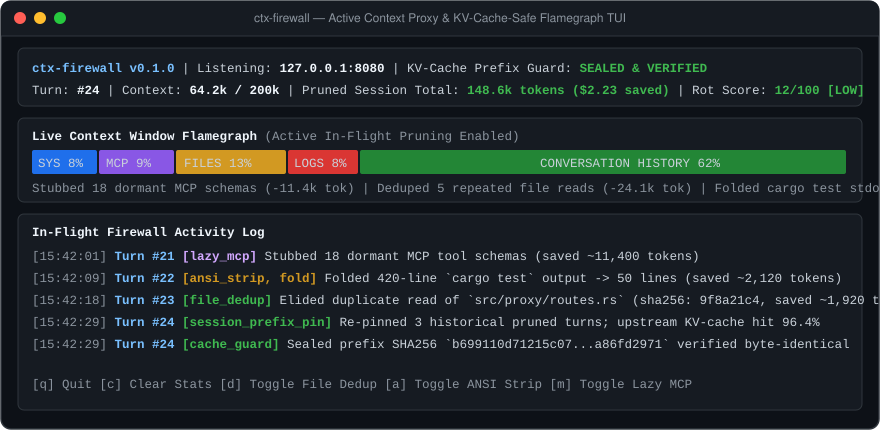

# ctx-firewall

Active LLM context proxy and terminal profiler that prunes redundant tool outputs in-flight while preserving prompt cache prefixes.

[](https://github.com/abhinavm-web/ctx-firewall/actions/workflows/ci.yml)
[](https://github.com/abhinavm-web/ctx-firewall/releases)
[](LICENSE)
[](Cargo.toml)

<p align="center">
  
</p>

## Overview

Long agent sessions accumulate repeated `read_file` payloads, ANSI escape sequences from test runners, and unused MCP tool schemas. Naive prompt compressors that rewrite early messages invalidate Anthropic and OpenAI prompt cache prefixes.

`ctx-firewall` runs as a local HTTP/SSE proxy (`ANTHROPIC_BASE_URL` / `OPENAI_BASE_URL`) with a `ratatui` terminal dashboard:

- **Duplicate file read deduplication**: Replaces repeated reads of identical file contents with short reference tombstones (`[ctx-firewall: content identical to previous read...]`).
- **Immediate re-read recovery**: If an agent receives a deduplication tombstone on Turn `N` and immediately calls `read_file` on the same path on Turn `N+1`, deduplication is bypassed so the agent receives the full unpruned file.
- **ANSI stripping and shell log folding**: Strips terminal escape sequences and folds verbose build/test output for shell tool calls (`bash`, `run_command`), leaving `read_file` outputs untruncated.
- **Lazy MCP schema stubbing**: Compresses inactive MCP tool definitions until referenced in the conversation.
- **Session-stateful KV-cache prefix pinning**: Caches pruned outputs by `(tool_use_id, sha256)` and verifies SHA-256 prefix immutability via `SealedPrefixGuard` before forwarding upstream.

```text
  Coding Agent (Claude Code / Cursor / Codex / Custom)
                         |
            ANTHROPIC_BASE_URL / OPENAI_BASE_URL
                         v
  +---------------------------------------------------+
  |                   ctx-firewall                    |
  |  +-----------------+   +-----------------------+  |
  |  | Ratatui Live    |   | Cache-Safe Pruner     |  |
  |  | Flamegraph TUI  |   | - Dedupe file reads   |  |
  |  | + Rot Score     |   | - Strip ANSI/log noise|  |
  |  +-----------------+   | - Fold shell stdout   |  |
  |                        | - Lazy MCP schemas    |  |
  |                        +----------+------------+  |
  +-----------------------------------|---------------+
                                      v
                    Upstream LLM API (KV-Cache Intact)
```

## Installation

Install prebuilt binaries, download an archive from [GitHub Releases](https://github.com/abhinavm-web/ctx-firewall/releases/latest), or build from source:

```bash
# macOS (Apple Silicon) and Linux (x86_64)
curl -fsSL https://raw.githubusercontent.com/abhinavm-web/ctx-firewall/main/install.sh | sh
```

```powershell
# Windows (PowerShell)
irm https://raw.githubusercontent.com/abhinavm-web/ctx-firewall/main/install.ps1 | iex
```

From source:

```bash
git clone https://github.com/abhinavm-web/ctx-firewall.git
cd ctx-firewall
cargo run --example showcase
cargo install --path .
```

## Usage

### Start the proxy server

```bash
# Interactive TUI dashboard on port 8080
ctx-firewall serve --port 8080

# Headless logging mode
ctx-firewall serve --port 8080 --no-tui
```

### Route agent traffic through the proxy

```bash
# Anthropic clients / Claude Code
ANTHROPIC_BASE_URL=http://127.0.0.1:8080 claude

# OpenAI clients / Codex
OPENAI_BASE_URL=http://127.0.0.1:8080/v1 codex
```

### Inspect captured payloads offline

```bash
ctx-firewall check --file request.json
ctx-firewall stats
```

### Pruning flags

```bash
ctx-firewall serve \
  --port 8080 \
  --upstream-anthropic https://api.anthropic.com \
  --upstream-openai https://api.openai.com \
  --no-ansi      # disable ANSI stripping
  --no-fold      # disable log folding
  --no-dedup     # disable duplicate file read deduplication
  --no-lazy-mcp  # disable lazy MCP schema stubbing
```

## Benchmarks

Reproduce locally:

```bash
cargo run --release --example benchmark
```

Measured across a simulated 15-turn coding session (repeated `read_file` turns, 140-line ANSI build logs, 20 MCP tool schemas, and an immediate re-read recovery turn):

| Metric (15-Turn Coding Session) | Unpruned Baseline | `ctx-firewall` | Delta / Status |
| :--- | ---: | ---: | :--- |
| Billed input tokens | 130,074 | 51,562 | -60.4% |
| Eligible prefix cache hits | - | 13 / 13 turns | 100.0% preserved |
| Immediate re-read recovery | - | Full file restored on retry | Verified |
| Proxy overhead | 0 ms | 8.21 ms total | 0.55 ms / turn |

## Architecture

```text
src/
├── config.rs           # Clap CLI and Serve/Check/Stats configuration
├── models/
│   ├── anthropic.rs    # Anthropic Messages API and cache_control models
│   └── openai.rs       # OpenAI Chat Completions and tool models
├── prune/
│   ├── ansi.rs         # CSI/OSC escape sequence and carriage-return stripper
│   ├── dedup.rs        # Superseded file-read detector and re-read recovery
│   ├── logs.rs         # Head/tail log folder for shell outputs
│   ├── mcp.rs          # Context-aware MCP tool schema stubber
│   └── cache_guard.rs  # SHA-256 KV-cache prefix boundary verifier
├── proxy/
│   ├── routes.rs       # Axum endpoints (/v1/messages, /v1/chat/completions, /health)
│   ├── client.rs       # Upstream streaming HTTP forwarder
│   └── sse.rs          # Server-Sent Events usage and cache telemetry parser
├── metrics/
│   ├── rot.rs          # Context Rot Score (0-100) calculator
│   └── pricing.rs      # Token and cost savings estimator
└── tui/
    ├── app.rs          # Interactive terminal state and event loop
    ├── ui.rs           # Dashboard layout, metrics cards, and activity log
    └── stacked_bar.rs  # Horizontal context bar widget
```

## Development

```bash
cargo test
cargo clippy --all-targets -- -D warnings
```

## See Also

| Repository | Description |
| :--- | :--- |
| **[agent-fork](https://github.com/abhinavm-web/agent-fork)** | Workspace checkpointing, rewind, parallel worktrees, and cassette recording |
| **[diffmem](https://github.com/abhinavm-web/diffmem)** | Git diff-of-diffs episodic memory daemon and editor rule sync |
| **[reddiff](https://github.com/abhinavm-web/reddiff)** | Differential regression finder that emits runnable crash reproducers only |
| **[jitpipe](https://github.com/abhinavm-web/jitpipe)** | Sample-driven compiled Unix pipes (`sgrep`, `sawk`, `sjq`) |

## License

[MIT](LICENSE)
